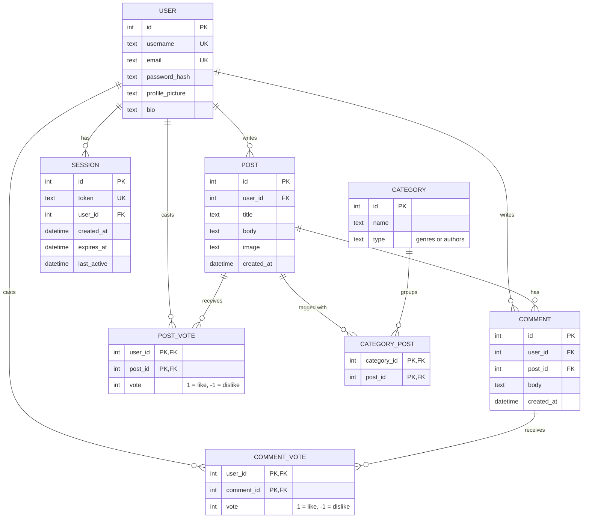

# Literary Lions Forum

A web forum for book lovers. Users can register, write posts about the books they read, attach images to their posts, comment, and like or dislike posts. Everyone can read the forum, even without an account.

Built with Go (standard library `net/http` and `html/template`), SQLite and plain HTML/CSS. The whole app runs in a single Docker container.

## Contents

- [Features](#features)
- [Running with Docker (recommended)](#running-with-docker-recommended)
  - Useful commands
  - Rebuilding after code changes
  - Cleaning up
- [Running without Docker](#running-without-docker)
- [Project structure](#project-structure)
- [Database](#database)
  - Entity relationship diagram
- [Routes](#routes)
- [How login works](#how-login-works)
- [Authors](#authors)

## Features

- **Accounts:** register with email, username and password, then log in and out.
  - Passwords are hashed with bcrypt.
  - Sessions are UUIDs stored in a cookie and in the database, and they expire after 15 minutes.
- **Posts:** logged-in users can write posts with a title, body text and an optional image (PNG, JPEG or GIF, max 5 MB). Empty posts are rejected (Both title and body are needed).
- **Comments:** logged-in users can comment on posts in a pop-up comment section. Empty comments are rejected.
- **Likes and dislikes:** logged-in users can like or dislike a post, but not both at once. Counts are visible to everyone.
- **Categories:** posts belong to genre and author categories.
- **Filtering and search:**
  - Filter posts by category.
  - Show only your own posts or the posts you have liked (requires login).
  - Sort the results.
  - Search posts with full-text search (SQLite FTS5).
- **Profiles:** each user has a public profile page and can edit their own profile.

## Running with Docker (recommended)

You only need [Docker](https://docs.docker.com/get-docker/) installed. Go and a C compiler are not needed, because the image builds everything inside.

Run these commands in the project root (the folder with the `Dockerfile`) or just use `make run` and open http://localhost:8080.

1. **Build the image:**
   ```sh
   docker build -t forum .
   ```
2. **Start a container:**
   ```sh
   docker run -d -p 8080:8080 --name forum-app forum
   ```
3. **Open the forum** at http://localhost:8080.

The container starts with example data: users, posts, categories, comments and votes.

### Useful commands

| What | Command |
| --- | --- |
| See running containers | `docker ps` |
| Read server logs | `docker logs forum-app` |
| Stop the forum | `docker stop forum-app` |
| Start it again (data is kept) | `docker start forum-app` |
| Remove the container (data is lost) | `docker rm -f forum-app` |
| Inspect image metadata (labels) | `docker image inspect forum` |

### Rebuilding after code changes

An image does not update by itself. After changing the code, rebuild and replace the container:

```sh
docker build -t forum .
docker rm -f forum-app
docker run -d -p 8080:8080 --name forum-app forum
```

Or just use `make rebuild` and open http://localhost:8080.

### Cleaning up

Rebuilding leaves old, unnamed images and build cache behind. Remove unused Docker objects with:

```sh
docker image prune -f        # old unnamed images
docker container prune -f    # stopped containers
docker builder prune -f      # build cache
```

`docker system prune` does all of these at once.

## Running without Docker

Requirements:
- Go 1.27 or newer.
- A C compiler (`gcc` or `clang`), because the SQLite driver `mattn/go-sqlite3` uses C code. On macOS, `xcode-select --install` provides one.

The command that starts the program in the root:
```sh
go run -tags sqlite_fts5 . -seed
```

Then open http://localhost:8080.

- `-tags sqlite_fts5` turns on full-text search in the SQLite driver. Without it, the server fails on startup.
- `-seed` fills an empty database with example data. Leave it out to start with an empty forum.

The database is created as `database.db` and uploaded images go to `uploads/`, both in the folder where the server is run.

## Project structure

```
main.go                    starts the server, opens the database, optional seeding
internal/
  database/                SQL: schema, queries, seed data
  handlers/                HTTP handlers and the router
  models/                  Go structs for users, posts, comments...
  service/                 logic between handlers and database (auth, filters...)
  template/
    templates/pages/       full pages
    templates/components/  reusable template pieces
    static/                CSS, fonts, icons (embedded into the binary)
uploads/                   user-uploaded images (created automatically)
Dockerfile                 two-stage build: compile with Go, run on small Alpine
```

Templates and static files are embedded into the binary with `go:embed`, so the compiled program is the only file the container needs.

## Database

### Entity relationship diagram



- Posts and categories are many-to-many, connected through `CATEGORY_POST`.
- The vote tables have a primary key of (user, post) or (user, comment), so a user has at most one vote per post or comment. The vote is either a like or a dislike, never both.
- Deleting a user or post also deletes everything that belongs to it (`ON DELETE CASCADE`).
- Not shown: the full-text search tables `post_fts` and `user_fts`. Triggers keep them in sync with the tables above automatically.

## Routes

| Method | Path | Description |
| --- | --- | --- |
| GET | `/` | Front page with posts, filters and search |
| GET, POST | `/register` | Registration form / create account |
| GET, POST | `/login` | Login form / log in |
| | `/logout` | Log out |
| POST | `/post` | Create a post (with optional image) |
| POST | `/{id}/comment` | Comment on post `{id}` |
| POST | `/posts/{id}/vote` | Like or dislike post `{id}` |
| | `/profile` | Own profile |
| POST | `/profile/edit` | Edit own profile |
| GET | `/users/{id}` | Public profile of user `{id}` |
| GET | `/static/...` | CSS, fonts, icons |
| GET | `/uploads/...` | Uploaded images |

## How login works

```
email + password
       ↓
find user by email
       ↓
compare password with the bcrypt hash
       ↓ correct
generate a UUID session token
       ↓
save the session in the database
       ↓
send the token to the browser as a cookie
       ↓
redirect to /
```

On every following request, the server reads the cookie, looks up the session in the database and finds which user it belongs to.

## Authors

Hari, Hang, Ville and Vivian. A kood.tech forum project.
